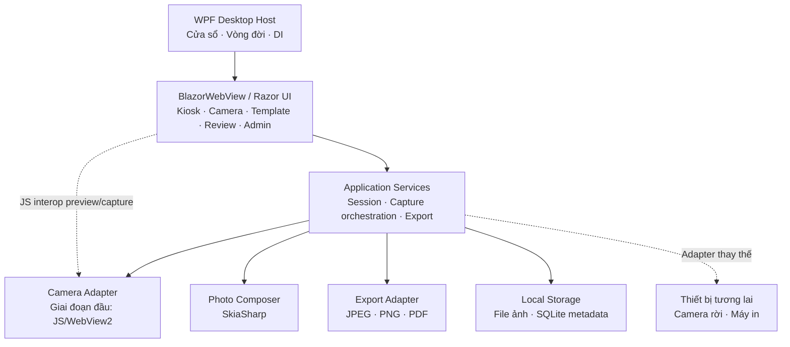

# Kiến trúc kỹ thuật — Photobooth Mini V1

**Trạng thái:** Kiến trúc mục tiêu, dùng làm chuẩn triển khai từng giai đoạn; không mặc định mọi module đã tồn tại.  
**Nền tảng đích:** Windows, .NET 10, WPF + BlazorWebView.  
**Nguyên tắc:** Offline-first, ưu tiên in-process, tách nghiệp vụ khỏi giao diện và thiết bị.

## 1. Lựa chọn kiến trúc

Ứng dụng được đóng gói như **một phần mềm desktop Windows**, không cần web server để vận hành luồng chụp ảnh cơ bản.

- **WPF:** host, cửa sổ, vòng đời ứng dụng, native dialogs khi cần, khởi tạo DI và xử lý sự kiện cấp hệ thống.
- **Blazor Hybrid (`BlazorWebView`):** giao diện Razor/HTML/CSS; Razor Components thực thi trong tiến trình .NET và hiển thị qua WebView2.
- **Application Services:** xử lý trạng thái phiên, điều phối chụp, ghép ảnh, xuất file.
- **Infrastructure:** camera adapter, bộ xử lý ảnh, hệ thống file, SQLite, print adapter (tương lai).

**Ghi chú kỹ thuật (19/11/2026):** `Photobooth.Desktop` dùng TFM `net10.0-windows10.0.17763.0`. BlazorWebView .NET 10 dùng `WebView2CompositionControl`, control này cần `Microsoft.Windows.SDK.NET`; với TFM `net10.0-windows` thuần, ứng dụng lỗi ngay khi mở cửa sổ (đã tái hiện thực tế). Hệ quả: yêu cầu tối thiểu **Windows 10 1809** và **WebView2 Runtime**.

Không triển khai React/Next.js, không tự tạo Web API/SignalR/HTTP localhost cho việc giao tiếp giữa Razor Components và C# nếu chưa có nhu cầu cụ thể.

## 2. Sơ đồ thành phần



**Lưu ý:** Đường liên kết Camera Adapter trong sơ đồ thể hiện sự phối hợp của một adapter truy cập JS interop tại tầng Desktop; không yêu cầu Application Services phải tham chiếu trực tiếp vào `IJSRuntime`.

## 3. Các lớp và trách nhiệm

| Lớp / module | Được phép làm | Không nên làm |
|---|---|---|
| `Photobooth.Desktop` | WPF host, Razor Pages/Components, JS interop bridge, DI composition root | Đặt logic ghép ảnh hoặc quy tắc nghiệp vụ dài trong component |
| `Photobooth.Application` | Quản lý session, điều phối quy trình, interface của thiết bị/lưu trữ | Phụ thuộc WebView2, SQLite provider hoặc thư viện webcam cụ thể |
| `Photobooth.Domain` | Định nghĩa dữ liệu lõi và trạng thái nghiệp vụ khi thực sự cần | Tham chiếu WPF/Blazor hoặc mã truy xuất file |
| `Photobooth.Infrastructure` | Ghép ảnh, ghi file, SQLite, adapter native (nếu có) | Điều khiển trực tiếp màn hình Razor hoặc workflow theo trạng thái UI |
| `Photobooth.Tests` | Unit/integration tests của logic có thể kiểm chứng tự động | Đòi hỏi webcam hoặc máy in thật cho toàn bộ test suite |

**Không bắt buộc tạo đủ 5 project ngay ở Mốc 1.** Có thể khởi đầu tối giản với Desktop, Application và Tests rồi tách thêm khi xuất hiện trách nhiệm thực tế.

## 4. Cấu trúc thư mục mục tiêu

```text
Photobooth/
├── AGENTS.md
├── docs/
│   ├── PROJECT_OVERVIEW.md
│   └── ARCHITECTURE.md
├── src/
│   ├── Photobooth.Desktop/
│   │   ├── App.xaml
│   │   ├── MainWindow.xaml
│   │   ├── Components/
│   │   │   ├── Pages/
│   │   │   └── Shared/
│   │   └── wwwroot/js/camera.js
│   ├── Photobooth.Application/
│   │   ├── Abstractions/
│   │   ├── Sessions/
│   │   └── Export/
│   ├── Photobooth.Domain/            # tạo khi cần
│   └── Photobooth.Infrastructure/    # tạo khi cần
└── tests/
    └── Photobooth.Tests/
```

Tên thư mục là **đề xuất**, không được tự động đổi cấu trúc repository đang có chỉ để khớp sơ đồ.

## 5. Cơ chế giao tiếp Blazor ↔ WPF ↔ C#

- Razor Components sử dụng DI để gọi các `Application Services` cùng tiến trình.
- WPF khởi tạo `ServiceCollection`, đăng ký `AddWpfBlazorWebView()` và các service của ứng dụng.
- Các thao tác native như chọn đường dẫn, tích hợp Window hoặc lifecycle được bọc sau interface phù hợp.
- `IJSRuntime` dùng cho **những API phải chạy trong ngữ cảnh trang WebView2**, ví dụ `navigator.mediaDevices.getUserMedia()` và `<video>`.
- Tránh sao chép ảnh độ phân giải lớn liên tục từ trình duyệt sang .NET trong vòng lặp preview. **Live preview nằm ở video element**; chỉ truyền dữ liệu khi thực sự chụp ảnh.
- Không thao tác UI WPF từ background thread trực tiếp; dùng cơ chế dispatch phù hợp khi cần.

### Điều cần chứng minh bằng POC

1. `BlazorWebView` khởi tạo thành công trên Windows mục tiêu.
2. Quyền camera của WebView2 được cấp **cho nguồn nội bộ đáng tin cậy** khi người dùng thực sự sử dụng camera.
3. `getUserMedia()` hoạt động với webcam laptop trong WebView2.
4. Hiển thị preview, chụp được một frame ảnh, chuyển dữ liệu về C# và lưu JPEG thành công.
5. Dừng camera và giải phóng stream; mở/đóng lặp lại không làm treo ứng dụng.

Nếu POC này thất bại, cần nghiên cứu native camera adapter (ví dụ dựa trên API multimedia Windows) và quyết định với người dùng; không giả định rằng camera browser luôn hoạt động trên mọi phiên bản WebView2.

## 6. Thiết kế Camera Adapter

### Mục tiêu

Chức năng điều phối chụp ảnh **không phụ thuộc trực tiếp vào loại thiết bị**. Có thể bắt đầu bằng webcam WebView2, về sau thay bằng camera USB/native hoặc SDK của máy ảnh.

Các khả năng nghiệp vụ cần tách:

- Liệt kê/chọn nguồn camera khi được hỗ trợ.
- Bắt đầu/dừng preview.
- Chụp một ảnh từ camera đang hoạt động.
- Phát hiện và phản hồi khi camera bị lỗi hoặc không có quyền truy cập.

Không bắt buộc cố ép `IJSRuntime` vào một service dùng được ở mọi nơi. **Adapter bridge có thể sống trong Desktop**, thực thi interface do Application định nghĩa.

Luồng V1 được ưu tiên:

```text
Razor Camera Component
    ↓ yêu cầu preview
JS camera.js (getUserMedia, video element)
    ↓ chụp từng frame theo yêu cầu
JS Interop → C# Capture Adapter
    ↓ PhotoCapture (bytes/stream + metadata)
Session Service → Lưu ảnh gốc
```

Ảnh gốc nên có thông tin tối thiểu: `SessionId`, `PhotoId`, thời gian, thứ tự trong phiên, kích thước, đường dẫn file.

## 7. Session và workflow

Trạng thái mục tiêu (có thể điều chỉnh sau khi code):

```text
Created
  ↓
Previewing
  ↓
Capturing (mặc định 4 ảnh)
  ↓
Reviewing ──→ Chụp lại (nếu được phép)
  ↓
Composing
  ↓
Ready
  ↓
Completed
```

Từ bất kỳ bước phù hợp nào đều có thể `Cancelled` hoặc `Failed`, kèm khả năng khôi phục dữ liệu đã lưu.

**Quy tắc:**

- Session Service là nơi điều phối trạng thái, không để mỗi Razor Page tự quyết định các chuyển trạng thái quan trọng.
- Mỗi ảnh gốc được lưu trước khi coi lần chụp tương ứng là thành công.
- Thất bại khi ghép ảnh/xuất PDF không được làm mất ảnh gốc.
- Không thực hiện cùng lúc hai phiên chụp trên một camera nếu chưa có chủ đích hỗ trợ.
- Cấu hình số ảnh và đếm ngược tập trung, không hardcode rải rác.

## 8. Photo Composition Engine

### Đầu vào

- Danh sách ảnh gốc theo thứ tự.
- Định nghĩa template (khổ canvas, `photoSlots`, màu nền, overlay, text tùy chọn).
- Tham số đầu ra (kích thước, chất lượng JPEG, tùy chọn crop).

### Xử lý

- Đọc và xác thực ảnh đầu vào; không để image decoder crash toàn bộ UI.
- Scale/crop với tỷ lệ đúng; không bóp méo ảnh để vừa khung.
- Vẽ lên canvas bằng engine C# — **SkiaSharp 3.119.4** (MIT), dùng cả cho mã hóa JPEG/PNG và tạo PDF (`SKDocument`), không cần thêm thư viện PDF.
- Mỗi template là một thư mục `src/Photobooth.Desktop/Templates/<tên>/` chứa `template.json` và asset (copy ra thư mục chạy); thêm template = thêm thư mục, không sửa Composer. Cấu trúc JSON: `docs/TEMPLATE_SCHEMA.md`.
- Ảnh gốc là khung hình thô của camera kèm cờ `Mirrored`; lật ngang chỉ thực hiện trong Composer/preview renderer (đúng một lần, chỉ ô ảnh).
- Ảnh thành phẩm lưu dạng PNG trong `Sessions/{SessionId}/Outputs/` và là nguồn chung cho JPEG/PNG/PDF.
- Có thể chạy ngoài UI thread, hỗ trợ cancel/hiển thị tiến độ ở mức hợp lý.
- Xuất ảnh thành phẩm tách biệt với ảnh gốc.

### Kích thước tham khảo

- Canvas raster mặc định: **1200 × 1800 px**, ứng với **4 × 6 inch ở 300 DPI**.
- PDF 4 × 6 inch: **288 × 432 point** (72 point/inch).
- Bố cục template phải kiểm tra tọa độ và biên cắt để tránh ảnh vượt canvas.
- Các thông số này **cấu hình được**; không hardcode chỉ một khổ hoặc một số lượng ảnh.

## 9. Xuất file và lưu trữ

- Ảnh gốc: lưu dưới thư mục riêng theo session.
- Ảnh thành phẩm: một hoặc nhiều bản xuất JPEG/PNG theo template/phiên.
- PDF: tạo từ ảnh thành phẩm với kích thước trang vật lý đúng.
- Lưu an toàn: ghi file tạm nếu phù hợp, hoàn tất file rồi mới cập nhật trạng thái thành công; dọn file tạm bị lỗi có kiểm soát.
- Ngăn ghi đè ngoài ý muốn, kiểm tra lỗi hết dung lượng ổ đĩa/đường dẫn không tồn tại/quyền truy cập.

Cấu trúc dữ liệu tham khảo (không bắt buộc):

```text
%LOCALAPPDATA%/Photobooth/
├── Data/photobooth.db
├── Sessions/{SessionId}/Originals/
├── Sessions/{SessionId}/Outputs/
└── Logs/
```

Trong V1, có thể lưu metadata cục bộ bằng JSON hoặc SQLite tùy mốc triển khai; **SQLite là hướng lưu trữ metadata chính**, không lưu toàn bộ bytes ảnh vào database.

## 10. Xử lý lỗi và vòng đời ứng dụng

- Quản lý các trạng thái: không có camera, thiếu quyền, webcam đang được ứng dụng khác sử dụng, ngắt thiết bị, lỗi đọc/ghi ảnh.
- Đăng ký logging cho exception cấp ứng dụng và WebView2 khi có API phù hợp.
- Khi WebView2 renderer gặp lỗi, cố gắng khôi phục giao diện an toàn; không giả định có thể tự phục hồi mọi lỗi.
- Trạng thái nghiệp vụ cần sống ngoài vòng đời của một Razor Component đơn lẻ.
- Dừng preview và release camera khi kết thúc phiên/đóng ứng dụng.
- Không tự cấp quyền camera hoặc mở URL ngoài không tin cậy trong WebView2.

## 11. Kiểm thử và định nghĩa đạt mốc

| Nhóm | Kiểm thử |
|---|---|
| Build | `dotnet build` trên Windows SDK tương thích |
| Unit test | Tính khung, thứ tự ảnh, trạng thái session, đặt tên file |
| Integration test | Ghép ảnh mẫu, xuất JPEG/PNG/PDF, lỗi đường dẫn/ghi file |
| UI thực tế | Mở/đóng màn hình camera, chụp một và nhiều ảnh, thử lại |
| WebView2 | Quyền camera, mất camera, đóng/mở liên tục, lỗi renderer |
| Offline | Tắt mạng, vẫn chụp/ghép/xuất được |
| Máy khác | Đóng gói và chạy thử trên máy Windows không cài môi trường dev |

Không coi mock camera hoặc unit test là đủ để xác nhận webcam trên máy thực tế hoạt động. Việc xác minh phần cứng mới chỉ được thực hiện khi có thiết bị đó.

## 12. Những lựa chọn chưa khóa

- Gói NuGet phiên bản cụ thể: lựa chọn khi tạo Solution, bảo đảm tương thích .NET 10 và kiểm tra giấy phép.
- Sử dụng SQLite ngay từ mốc đầu hay từ giai đoạn quản trị.
- Native camera adapter dự phòng nếu WebView2 không phù hợp.
- Tool đóng gói/cập nhật ứng dụng Windows.
- Có triển khai print queue mock ngay V1 hay để sau khi các chức năng chụp/xuất ảnh ổn định.

Đối với các vấn đề chưa khóa, AI phải trình bày đánh đổi kỹ thuật và **không tự coi đề xuất thành yêu cầu bắt buộc**.

## 13. Tài liệu kỹ thuật tham khảo

- Microsoft — Blazor Hybrid: https://learn.microsoft.com/aspnet/core/blazor/hybrid/?view=aspnetcore-10.0
- Microsoft — Tạo WPF Blazor App: https://learn.microsoft.com/aspnet/core/blazor/hybrid/tutorials/wpf?view=aspnetcore-10.0
- Microsoft — Bảo mật Blazor Hybrid/WebView2: https://learn.microsoft.com/aspnet/core/blazor/hybrid/security/security-considerations?view=aspnetcore-10.0
- Microsoft — Quyền WebView2: https://learn.microsoft.com/microsoft-edge/webview2/concepts/permissions-api
