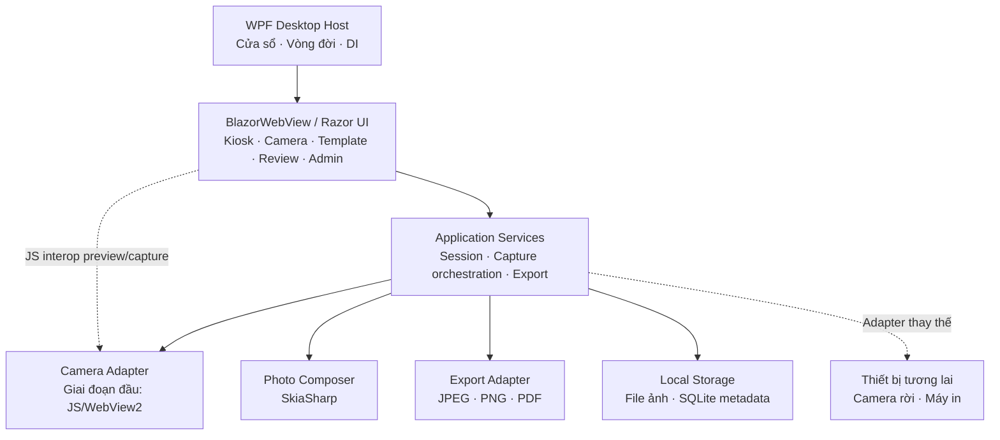

# Kiến trúc kỹ thuật — Photobooth Mini V1

**Trạng thái:** Kiến trúc mục tiêu, dùng làm chuẩn triển khai từng giai đoạn; không mặc định mọi module đã tồn tại.  
**Nền tảng đích:** Windows, .NET 10, WPF + BlazorWebView.  
**Nguyên tắc:** Offline-first, ưu tiên in-process, tách nghiệp vụ khỏi giao diện và thiết bị.

## 1. Lựa chọn kiến trúc

Ứng dụng được đóng gói như **một phần mềm desktop Windows**, không cần web server để vận hành luồng chụp ảnh cơ bản.

- **WPF:** host, cửa sổ, vòng đời ứng dụng, native dialogs khi cần, khởi tạo DI và xử lý sự kiện cấp hệ thống.
- **Blazor Hybrid (`BlazorWebView`):** giao diện Razor/HTML/CSS; Razor Components thực thi trong tiến trình .NET và hiển thị qua WebView2.
- **Application Services:** xử lý trạng thái phiên, điều phối chụp, ghép ảnh, xuất file.
- **Infrastructure:** camera adapter, bộ xử lý ảnh, hệ thống file, SQLite, print adapter (tương lai).

**Ghi chú kỹ thuật (19/11/2026):** `Photobooth.Desktop` dùng TFM `net10.0-windows10.0.17763.0`. BlazorWebView .NET 10 dùng `WebView2CompositionControl`, control này cần `Microsoft.Windows.SDK.NET`; với TFM `net10.0-windows` thuần, ứng dụng lỗi ngay khi mở cửa sổ (đã tái hiện thực tế). Hệ quả: yêu cầu tối thiểu **Windows 10 1809** và **WebView2 Runtime**.

Không triển khai React/Next.js, không tự tạo Web API/SignalR/HTTP localhost cho việc giao tiếp giữa Razor Components và C# nếu chưa có nhu cầu cụ thể.

## 2. Sơ đồ thành phần



**Lưu ý:** Đường liên kết Camera Adapter trong sơ đồ thể hiện sự phối hợp của một adapter truy cập JS interop tại tầng Desktop; không yêu cầu Application Services phải tham chiếu trực tiếp vào `IJSRuntime`.

## 3. Các lớp và trách nhiệm

| Lớp / module | Được phép làm | Không nên làm |
|---|---|---|
| `Photobooth.Desktop` | WPF host, Razor Pages/Components, JS interop bridge, DI composition root | Đặt logic ghép ảnh hoặc quy tắc nghiệp vụ dài trong component |
| `Photobooth.Application` | Quản lý session, điều phối quy trình, interface của thiết bị/lưu trữ | Phụ thuộc WebView2, SQLite provider hoặc thư viện webcam cụ thể |
| `Photobooth.Domain` | Định nghĩa dữ liệu lõi và trạng thái nghiệp vụ khi thực sự cần | Tham chiếu WPF/Blazor hoặc mã truy xuất file |
| `Photobooth.Infrastructure` | Ghép ảnh, ghi file, SQLite, adapter native (nếu có) | Điều khiển trực tiếp màn hình Razor hoặc workflow theo trạng thái UI |
| `Photobooth.Tests` | Unit/integration tests của logic có thể kiểm chứng tự động | Đòi hỏi webcam hoặc máy in thật cho toàn bộ test suite |

**Không bắt buộc tạo đủ 5 project ngay ở Mốc 1.** Có thể khởi đầu tối giản với Desktop, Application và Tests rồi tách thêm khi xuất hiện trách nhiệm thực tế.

## 4. Cấu trúc thư mục mục tiêu

```text
Photobooth/
├── AGENTS.md
├── docs/
│   ├── PROJECT_OVERVIEW.md
│   └── ARCHITECTURE.md
├── src/
│   ├── Photobooth.Desktop/
│   │   ├── App.xaml
│   │   ├── MainWindow.xaml
│   │   ├── Components/
│   │   │   ├── Pages/
│   │   │   └── Shared/
│   │   └── wwwroot/js/camera.js
│   ├── Photobooth.Application/
│   │   ├── Abstractions/
│   │   ├── Sessions/
│   │   └── Export/
│   ├── Photobooth.Cloud/             # web lưu trữ/chia sẻ ảnh, deploy độc lập (Phase Cloud 1)
│   ├── Photobooth.Domain/            # tạo khi cần
│   └── Photobooth.Infrastructure/    # tạo khi cần
└── tests/
    ├── Photobooth.Tests/
    └── Photobooth.Cloud.Tests/       # test riêng cho Photobooth.Cloud
```

Tên thư mục là **đề xuất**, không được tự động đổi cấu trúc repository đang có chỉ để khớp sơ đồ.

## 5. Cơ chế giao tiếp Blazor ↔ WPF ↔ C#

- Razor Components sử dụng DI để gọi các `Application Services` cùng tiến trình.
- WPF khởi tạo `ServiceCollection`, đăng ký `AddWpfBlazorWebView()` và các service của ứng dụng.
- Các thao tác native như chọn đường dẫn, tích hợp Window hoặc lifecycle được bọc sau interface phù hợp.
- `IJSRuntime` dùng cho **những API phải chạy trong ngữ cảnh trang WebView2**, ví dụ `navigator.mediaDevices.getUserMedia()` và `<video>`.
- Tránh sao chép ảnh độ phân giải lớn liên tục từ trình duyệt sang .NET trong vòng lặp preview. **Live preview nằm ở video element**; chỉ truyền dữ liệu khi thực sự chụp ảnh.
- Không thao tác UI WPF từ background thread trực tiếp; dùng cơ chế dispatch phù hợp khi cần.

### Điều cần chứng minh bằng POC

1. `BlazorWebView` khởi tạo thành công trên Windows mục tiêu.
2. Quyền camera của WebView2 được cấp **cho nguồn nội bộ đáng tin cậy** khi người dùng thực sự sử dụng camera.
3. `getUserMedia()` hoạt động với webcam laptop trong WebView2.
4. Hiển thị preview, chụp được một frame ảnh, chuyển dữ liệu về C# và lưu JPEG thành công.
5. Dừng camera và giải phóng stream; mở/đóng lặp lại không làm treo ứng dụng.

Nếu POC này thất bại, cần nghiên cứu native camera adapter (ví dụ dựa trên API multimedia Windows) và quyết định với người dùng; không giả định rằng camera browser luôn hoạt động trên mọi phiên bản WebView2.

## 6. Thiết kế Camera Adapter

### Mục tiêu

Chức năng điều phối chụp ảnh **không phụ thuộc trực tiếp vào loại thiết bị**. Có thể bắt đầu bằng webcam WebView2, về sau thay bằng camera USB/native hoặc SDK của máy ảnh.

Các khả năng nghiệp vụ cần tách:

- Liệt kê/chọn nguồn camera khi được hỗ trợ. Đã có cho webcam (26/11/2026): `enumerateDevices()` trong WebView2 → Admin › Camera; lựa chọn (`deviceId` + tên) lưu trong SQLite bảng `DeviceSettings` qua `CameraSelectionService`; `camera.js` mở đúng `deviceId`, đổi mã thì tìm lại theo tên (chỉ khi đúng một camera trùng tên), không có thì trả `CameraError.SelectedDeviceNotFound`.
- Bắt đầu/dừng preview.
- Chụp một ảnh từ camera đang hoạt động.
- Phát hiện và phản hồi khi camera bị lỗi hoặc không có quyền truy cập.

Không bắt buộc cố ép `IJSRuntime` vào một service dùng được ở mọi nơi. **Adapter bridge có thể sống trong Desktop**, thực thi interface do Application định nghĩa.

Luồng V1 được ưu tiên:

```text
Razor Camera Component
    ↓ yêu cầu preview
JS camera.js (getUserMedia, video element)
    ↓ chụp từng frame theo yêu cầu
JS Interop → C# Capture Adapter
    ↓ PhotoCapture (bytes/stream + metadata)
Session Service → Lưu ảnh gốc
```

Ảnh gốc nên có thông tin tối thiểu: `SessionId`, `PhotoId`, thời gian, thứ tự trong phiên, kích thước, đường dẫn file.

### Máy ảnh Canon qua EDSDK (bổ sung 26/11/2026 — đang kiểm chứng)

- Nguồn camera tùy chọn, hiện thực `ICameraDevice` bằng Canon EDSDK (P/Invoke tới `EDSDK.dll` 64-bit, khai báo lấy từ `EDSDK.cs` trong sample chính thức của Canon, **không** dùng binding bên thứ ba).
- `EDSDK.dll`/`EdsImage.dll` (x64) được đưa vào repo tại `lib/EDSDK/win-x64/`.
- Ảnh gốc được tải từ máy ảnh về bộ nhớ (`SaveTo = Host`) rồi đi qua cùng luồng lưu ảnh gốc như webcam.
- Spike nằm ở `tools/CanonSpike/`, ngoài solution chính.
- `EDSDK.cs` của Canon dùng `UnmanagedType.AsAny` cho `EdsSetPropertyData` — **không chạy trên .NET 10**; phải bổ sung overload kiểu cụ thể (xem `tools/CanonSpike/Native/EdsInterop.cs`).

**Kết quả spike trên EOS M50 Mark II (26/11/2026, thử thật):**

| Hạng mục | Kết quả |
|---|---|
| Luồng | Toàn bộ lệnh SDK và callback chạy trên **một luồng STA có Win32 message pump**; không cần `EdsGetEvent` |
| Chụp | Gửi `PressShutterButton` → nhận `ObjectEvent_DirItemRequestTransfer` → `EdsDownload` vào memory stream: ~1,4 s/ảnh, ảnh gốc 6000×4000 JPEG có EXIF |
| Lỗi chụp | `EDS_ERR_TAKE_PICTURE_AF_NG` (không lấy được nét), `0x8D0C` (máy đang ở chế độ quay phim) trả về **ngay khi gửi lệnh**, không cần chờ timeout |
| Live View | ~30 fps, JPEG 960×640 ~185 KB/khung (~5,5 MB/s); không xung đột khi vừa kéo khung vừa chờ ảnh chụp. Số byte thật lấy bằng `EdsGetPosition`, không dùng `EdsGetLength` (trả về kích thước bộ đệm) |
| Mất kết nối | Rút cáp/tắt máy → `StateEvent_Shutdown` (3/3 lần). Ngay sau khi cắm lại, máy có thể chưa xuất hiện trong danh sách vài giây → kết nối lại phải có thử lại |
| Tên file trên máy | Đếm lại từ `IMG_0001` mỗi lần kết nối → không dùng làm định danh ảnh |

**Triển khai (Giai đoạn 2, 26/11/2026) — project `src/Photobooth.Camera.Canon`** (`net10.0-windows`, chỉ tham chiếu `Photobooth.Application`):

- `CanonSdkHost` (singleton): một luồng STA riêng khởi tạo/kết thúc SDK một lần, thực thi tuần tự mọi lệnh SDK và pump Windows message để nhận callback. Thiếu `EDSDK.dll`/sai kiến trúc → `CameraError.NotSupported`, không làm sập ứng dụng.
- `CanonCameraDevice : ICameraDevice`: `StartAsync` tìm máy, mở session, `SaveTo = Host` (thử lại khi máy chưa xuất hiện/bận); `CaptureFrameAsync` bấm–nhả nút chụp → chờ ảnh mới bằng `TaskCompletionSource` (timeout/hủy) → tải JPEG gốc vào bộ nhớ. Chế độ RAW+JPEG: bỏ file RAW. Ảnh không do ứng dụng yêu cầu hoặc đến muộn: báo hủy với máy ảnh. `StateEvent_Shutdown` → `Faulted(CameraError.Disconnected)`; `StateEvent_WillSoonShutDown` → gia hạn hẹn giờ tắt nguồn.
- `IEdsApi`/`NativeEdsApi`: lớp mỏng quanh EDSDK để kiểm thử bằng SDK giả (`tests/Photobooth.Camera.Canon.Tests`).
- `CanonCameraDirectory`: liệt kê máy Canon đang kết nối (không mở session) cho Admin › Camera. Desktop tham chiếu project này từ 26/11/2026; `CanonSdkHost` chỉ được tạo khi mở Admin › Camera.
- **Live View (Giai đoạn 3, 26/11/2026):** `CanonCameraDevice.StartLiveViewAsync` bật `Evf_OutputDevice |= PC` và chạy vòng lấy khung; mỗi khung là một công việc riêng trên luồng SDK (lệnh chụp xen vào được) và được đưa vào `LiveViewFrameBuffer` ngay trên luồng SDK (không thể có khung cũ sau khi mất kết nối). Bộ đệm chỉ giữ khung mới nhất.
- **Truyền khung lên giao diện:** `LiveViewEndpoint` (Desktop) chặn `https://liveview.photobooth/canon/frame?after={seq}` bằng `WebResourceRequested` của WebView2 và trả JPEG nhị phân — không Base64, không mở cổng mạng, chỉ phục vụ origin nội bộ của ứng dụng. Yêu cầu được giữ tối đa 1 giây tới khi có khung mới; `wwwroot/js/liveview.js` chỉ xin khung tiếp theo sau khi vẽ xong khung trước lên `<canvas>`, nên tự điều tiết tốc độ.
- **Thông số máy ảnh (26/11/2026):** `CanonCameraDevice.ReadSettingsAsync`/`SetSettingAsync`, chia 4 nhóm — Phơi sáng: chế độ chụp (chỉ đọc — vòng chế độ vật lý), ISO, khẩu độ, tốc độ, bù sáng; Màu sắc: cân bằng trắng, nhiệt độ màu (chỉ khi cân bằng trắng = Kelvin), Picture Style và chi tiết của kiểu đang chọn (tương phản, bão hòa, tông màu, độ nét — đọc/ghi `EdsPictureStyleDesc` theo mã kiểu; máy không hỗ trợ thì ẩn; **chưa kiểm chứng trên M50 Mark II**); Lấy nét: kiểu lấy nét Live View (khuôn mặt + bám theo…), thao tác lấy nét; Ảnh và vận hành: chất lượng ảnh (**chỉ cho chọn JPEG** — RAW/HEIF làm hỏng luồng chụp), tỉ lệ khung, tự tắt nguồn. Tỉ lệ khung và tự tắt nguồn là thuộc tính riêng (0x01…): adapter mở khóa trước `EdsOpenSession` như sample Canon. Giả định ánh sáng mặc định: đèn LED trắng liên tục — bộ đi kèm "Đèn LED trắng (điểm khởi đầu)" (M, 1/125, f/5.6, ISO 800, 5500 K, Chân dung, khuôn mặt + bám theo, JPEG L Fine, 3:2, không tự tắt). Danh sách giá trị lấy từ máy (`EdsGetPropertyDesc`) nên chỉ hiện giá trị hợp lệ ở chế độ hiện tại; bảng mã → nhãn trong `CanonSettingCatalog` (theo sample Canon). Giá trị được đặt thẳng lên máy ảnh và máy tự ghi nhớ. Máy báo đổi thuộc tính (`PropertyEvent`) → `SettingsChanged` → Admin đọc lại.
- **Tham chiếu tham số/mã giá trị cho người dựng bộ thông số:** `docs/CANON_CAMERA_SETTINGS.md` (sinh từ `CanonSettingCatalog` bằng `tools/CameraSettingsDoc`).
- **Trạng thái máy (chỉ đọc):** `ReadStatusAsync` → % pin (`BatteryLevel`; `0xFFFFFFFF` = nguồn AC), mức cảnh báo nhiệt (`TempStatus`, thuộc tính riêng — Canon không cung cấp °C, chỉ mức: bình thường / nóng / giảm khung hình / tắt Live View / không cho chụp), tên ống kính. Cập nhật qua `StatusChanged` (PropertyEvent) và đọc lại định kỳ 30 giây trong Admin; cảnh báo khi pin < 20% hoặc quá nóng.
- **Bộ thông số (preset):** quản trị viên lưu thông số đang chỉnh được thành bộ có tên (`CanonPreset`, chỉ lưu thông số đang chỉnh được + chế độ chụp lúc lưu để cảnh báo) và nhấn "Áp dụng" để đưa máy về đúng mẫu (`ApplyPresetAsync`: cân bằng trắng trước nhiệt độ màu; thông số không đặt được ở trạng thái hiện tại được bỏ qua kèm lý do). **Không lưu theo sự kiện; cùng mô hình Template Library** (đã chốt 26/11/2026): thư viện `%LOCALAPPDATA%/Photobooth/CameraPresets`, mỗi bộ một file `{id}.json` (`CanonPresetStore`, ghi tạm rồi đổi tên). Bộ đi kèm ứng dụng nằm ở `src/Photobooth.Desktop/CameraPresets/*.json`, được chép cạnh `Photobooth.exe` khi build/publish và chỉ dùng để khởi tạo thư viện lần đầu — thư viện đã có thì không bao giờ bị chép đè. Nhập/xuất file `.json` để chia sẻ giữa các máy; muốn thêm bộ mẫu đi kèm ứng dụng thì xuất rồi lưu vào thư mục nguồn đó. Máy đã có thư viện: nút "Thêm bộ mẫu còn thiếu" (`AddMissingBundledAsync`) chép các bộ đi kèm chưa có (theo mã), không ghi đè bộ đang có.
- Hiện Live View và thông số chỉ dùng trong Admin › Camera. Chưa có: chọn Canon làm nguồn camera cho Kiosk (Giai đoạn 4). Kiểm tra thủ công với máy thật: `tools/CanonAdapterCheck`.

## 7. Session và workflow

Trạng thái mục tiêu (có thể điều chỉnh sau khi code):

```text
Created
  ↓
Previewing
  ↓
Capturing (số ảnh theo template đã chọn)
  ↓
Reviewing ──→ Chụp lại (nếu được phép)
  ↓
Composing
  ↓
Ready
  ↓
Completed
```

Từ bất kỳ bước phù hợp nào đều có thể `Cancelled` hoặc `Failed`, kèm khả năng khôi phục dữ liệu đã lưu.

**Quy tắc:**

- Session Service là nơi điều phối trạng thái, không để mỗi Razor Page tự quyết định các chuyển trạng thái quan trọng.
- Mỗi ảnh gốc được lưu trước khi coi lần chụp tương ứng là thành công.
- Thất bại khi ghép ảnh/xuất PDF không được làm mất ảnh gốc.
- Không thực hiện cùng lúc hai phiên chụp trên một camera nếu chưa có chủ đích hỗ trợ.
- Số ảnh mỗi phiên lấy từ template (`PhotoTemplate.RequiredPhotoCount`) và được chốt vào phiên khi chọn template; đếm ngược và giới hạn an toàn số ảnh nằm tập trung trong `CaptureOptions`, không hardcode rải rác.

## 8. Photo Composition Engine

### Đầu vào

- Danh sách ảnh gốc theo thứ tự.
- Định nghĩa template (khổ canvas, `photoSlots`, màu nền, overlay, text tùy chọn).
- Tham số đầu ra (kích thước, chất lượng JPEG, tùy chọn crop).

### Xử lý

- Đọc và xác thực ảnh đầu vào; không để image decoder crash toàn bộ UI.
- Scale/crop với tỷ lệ đúng; không bóp méo ảnh để vừa khung.
- Vẽ lên canvas bằng engine C# — **SkiaSharp 3.119.4** (MIT), dùng cả cho mã hóa JPEG/PNG và tạo PDF (`SKDocument`), không cần thêm thư viện PDF.
- Mỗi template là một thư mục chứa `template.json` và asset trong **Template Library** (`%LOCALAPPDATA%\Photobooth\Templates`, khởi tạo một lần từ `src/Photobooth.Desktop/Templates/` đi kèm ứng dụng); thêm template = thêm thư mục, không sửa Composer. Cấu trúc JSON: `docs/TEMPLATE_SCHEMA.md`.
- Ảnh gốc là khung hình thô của camera kèm cờ `Mirrored`; lật ngang chỉ thực hiện trong Composer/preview renderer (đúng một lần, chỉ ô ảnh).
- Ảnh thành phẩm lưu dạng PNG trong `Sessions/{SessionId}/Outputs/` và là nguồn chung cho JPEG/PNG/PDF.
- Có thể chạy ngoài UI thread, hỗ trợ cancel/hiển thị tiến độ ở mức hợp lý.
- Xuất ảnh thành phẩm tách biệt với ảnh gốc.

### Photo Preview và Manual Crop (Phase 2.2)

```text
Chụp đủ ảnh → PhotoSessionService.ComposeAsync() → SkiaPhotoComposer (PNG master, độ phân giải canvas)
                                                     ├─→ Preview: IImagePreviewRenderer thu nhỏ PNG master
                                                     └─→ Export: JPEG/PNG/PDF đọc cùng PNG master
Trình chỉnh crop (JS, xem trước tạm bằng CSS) ──"Áp dụng"──→ ApplySlotCropAsync(slotIndex, SlotCrop) → ghép lại
```

- **Một engine duy nhất:** Preview là bản thu nhỏ của chính PNG master mà Export dùng, nên Preview và mọi định dạng xuất luôn cùng template, ảnh nguồn, bộ lọc và Manual Crop. Không có engine dựng ảnh thứ hai; HTML chỉ phủ các vùng chọn ô trong suốt (đặt theo % tọa độ template) lên ảnh.
- **`SlotCrop(Zoom, FocalX, FocalY)`** (`Application/Composition`) là dữ liệu phiên, lưu trong `PhotoSession.SlotCrops` theo **chỉ số ô** (không theo `photoIndex`), nên hai ô dùng chung ảnh vẫn cắt độc lập. Giá trị chuẩn hóa 0..1 theo hướng ảnh khách nhìn thấy (đã lật gương), không phụ thuộc kích thước màn hình/DPI. Không ghi vào `template.json`.
- **Cùng thuật toán Auto Crop:** `CropCalculator.Cover(..., focalX, focalY, zoom)`; Auto Crop = `zoom 1` + `focalPoint` của template. Vùng ảnh nguồn của một ô (kể cả đổi focal x khi ảnh chụp ở chế độ gương) được tính DUY NHẤT ở `CropCalculator.CoverSourceRect`, dùng chung cho `TemplateRenderer` và Camera Framing Overlay.
- **Camera Framing Overlay (Task 2.2.9):** `CaptureFraming.Compute(template, photoIndex, khung hình camera, gương)` trả khung chuẩn hóa 0..1 theo hướng khách nhìn; `WebViewCameraDevice` báo kích thước khung hình (kết quả `start` + sự kiện `resize` của video, chỉ khi đổi). `CaptureScreen` hiển thị bằng CSS: lớp phủ có đúng tỉ lệ khung hình, căn giữa như video `object-fit: contain` (container query units) nên trùng khít vùng nội dung video khi đổi kích thước cửa sổ/DPI; không xử lý theo từng frame, không dùng SkiaSharp. Ảnh chụp lấy từ chính khung hình video nên tỉ lệ ảnh chụp luôn bằng tỉ lệ preview. Vùng cắt luôn kẹp trong ảnh nên ô `cover` không bao giờ có khoảng trống. Giới hạn zoom 100–300% nằm duy nhất ở `SlotCrop.MinZoom/MaxZoom`. Ô `contain` chưa hỗ trợ chỉnh.
- **Trình chỉnh** (`CropEditor.razor` + `wwwroot/js/crop-editor.js`): Pointer Events (chuột + cảm ứng; một ngón kéo, hai ngón chụm/mở để zoom quanh trung điểm), nút −/+, con lăn chuột, `requestAnimationFrame`, `ResizeObserver`; mô phỏng đúng công thức `Cover` để xem trước tức thời, chỉ gửi trạng thái chuẩn hóa về .NET khi thả tay/dừng zoom. Không render C# theo từng sự kiện chuột; Photo Composer chỉ chạy khi "Áp dụng". Listener/observer được gỡ khi đóng trình chỉnh.
- **Không dùng kết quả cũ:** đổi crop, chụp lại ảnh hoặc đổi bộ lọc đều bỏ `Composed` cũ trước khi ghép lại; trong lúc ghép, mọi thao tác chỉnh/xuất bị khóa (một tác vụ ghép tại một thời điểm).

### Template Library, Template Manager và Visual Template Editor (Phase 3)

```text
Admin › Khung ảnh
  TemplateManagerPanel ──→ TemplateLibrary (Infrastructure, singleton, cũng là ITemplateCatalog cho Kiosk)
  TemplateEditorPanel  ──→ TemplateEditor/TemplateDraft (Application, thuần, có test)
          │ JS: template-editor.js (Pointer Events, ResizeObserver, phím tắt) — không tính tọa độ
          ├─ Lưu ─→ TemplateLibrary.SaveAsync: JsonTemplateCatalog.ValidateWithFiles → SafeFileWriter → thumbnail
          └─ Xem thử ─→ IPhotoComposer.RenderTemplateSampleAsync → TemplateRenderer (cùng DrawPhoto/Auto Crop)
```

- **`TemplateLibrary`** (`Infrastructure/Templates`): liệt kê (kể cả template lỗi, kèm lỗi), tạo/sao chép/đổi tên/xóa/bật-tắt/nhập/xuất, lưu từ Editor, thêm/đọc asset. Mọi thay đổi chạy tuần tự (`SemaphoreSlim`), ghi kiểu tạm-rồi-đổi-tên; thư mục mới dựng trong `.staging` rồi `Directory.Move`. Khóa thư mục được kiểm tra chỉ một cấp dưới thư viện (chặn `..`/đường dẫn tuyệt đối); asset đi qua `TemplateAssetResolver`. Trạng thái bật/tắt ở `library.json`, không thuộc template. `GetTemplatesAsync` (Kiosk) chỉ trả template hợp lệ và đang bật. Gói `.zip` dùng `System.IO.Compression` (có sẵn trong .NET), giải nén an toàn trong `TemplatePackage`.
- **`TemplateDraft`/`EditorElement`** bọc nguyên `TemplateSlot`/`TemplateDecoration` của Engine (không có model thứ hai, không mất thuộc tính). `Layers` = thứ tự vẽ (`TemplateLayers.GetRenderOrder`); `NormalizeLayers` gán `zIndex` tối thiểu để thứ tự Engine trùng thứ tự lớp. `TemplateEditor` giữ Undo/Redo (bản nháp bất biến), lựa chọn và thao tác kéo (một lần kéo = một bước Undo, tính lại từ khung ban đầu nên không tích lũy sai số).
- **`CanvasGeometry`**: đổi độ dời màn hình → pixel canvas, đổi kích thước theo 8 tay nắm (không lật ngược, tối thiểu 1 px, Shift giữ tỉ lệ, bắt dính lưới tùy chọn).
- **Không thêm package:** UI bằng Razor + CSS; JS chỉ chuyển sự kiện con trỏ/kích thước vùng xem/phím tắt sang .NET (gộp theo `requestAnimationFrame`, không gửi chồng lời gọi).
- Kiosk/Session không đổi: `TemplateSelectionScreen` vẫn dùng `ITemplateCatalog`; phiên vẫn lưu snapshot template khi lưu phiên.

### Kích thước tham khảo

- Canvas raster mặc định: **1200 × 1800 px**, ứng với **4 × 6 inch ở 300 DPI**.
- PDF 4 × 6 inch: **288 × 432 point** (72 point/inch).
- Bố cục template phải kiểm tra tọa độ và biên cắt để tránh ảnh vượt canvas.
- Các thông số này **cấu hình được**; không hardcode chỉ một khổ hoặc một số lượng ảnh.

## 9. Xuất file và lưu trữ

- Ảnh gốc: lưu dưới thư mục riêng theo session.
- Ảnh thành phẩm: một hoặc nhiều bản xuất JPEG/PNG theo template/phiên.
- PDF: tạo từ ảnh thành phẩm với kích thước trang vật lý đúng.
- Lưu an toàn: ghi file tạm nếu phù hợp, hoàn tất file rồi mới cập nhật trạng thái thành công; dọn file tạm bị lỗi có kiểm soát.
- Ngăn ghi đè ngoài ý muốn, kiểm tra lỗi hết dung lượng ổ đĩa/đường dẫn không tồn tại/quyền truy cập.

**Quyết định 19/11/2026 — Event Workspace, file-based (chi tiết: `docs/EVENT_STORAGE.md`):**

- File của phiên nằm trong thư mục sự kiện do người vận hành chọn: `{Sự kiện}/Sessions/{yyyyMMdd-HHmmss-xxxxxxxx}/` gồm `Template/` (snapshot + asset), `Originals/`, `Outputs/final-v{N}.png`, `Drafts/`.
- `%LOCALAPPDATA%/Photobooth/` gồm log, **`photobooth.db`** (SQLite chứa cả cấu hình thiết bị) và hồ sơ WebView2. Cấu hình Desktop dùng `src/Photobooth.Desktop/appsettings.json`, được copy cạnh file `.exe` khi build/publish.
- Log Desktop: file `photobooth-yyyyMMdd.log`, mặc định ở `%LOCALAPPDATA%/Photobooth/Logs`. Đổi được bằng mục `logging` trong `appsettings.json` (từ 26/11/2026): `directory` (tuyệt đối, có biến môi trường, hoặc tương đối so với `%LOCALAPPDATA%/Photobooth`) và `minimumLevel` (Trace…Critical, mặc định Information). Giá trị sai hoặc thư mục không ghi được → dùng mặc định cho riêng phần log và ghi cảnh báo; các cấu hình khác không bị ảnh hưởng.
- **Cập nhật 23/11/2026 — metadata chuyển sang SQLite** (xem §9.1). Bản JSON cũ (`session.json`, `cloud-upload.json`, danh bạ sự kiện trong `app-state.json`) **không còn là nguồn dữ liệu** và không được chuyển sang database.
- Thành phần:
  - `EventWorkspaceService` (Infrastructure): chọn/mở/tạo/kiểm tra sự kiện; bảng `Events` (danh bạ, sự kiện mở gần nhất, tên); `event.json` chỉ là dấu nhận diện thư mục.
  - `ISessionArchive` → `EventSessionArchive`: cấp thư mục phiên, ghi metadata phiên vào SQLite trong một transaction, ghi snapshot template (file), tạo phiên bản thành phẩm, liệt kê và mở lại phiên (đường dẫn trong database được kiểm tra không thoát khỏi thư mục sự kiện).
  - `PhotoSessionService` (partial `PhotoSessionService.Archive.cs`): ghi metadata sau mỗi ảnh/phiên bản/xuất/in; `ConfirmOutputAsync` (phiên bản bất biến); mở lại, chỉnh sửa lại, hủy/lưu; `RequestPrintAsync`.
  - `PhotoboothStoragePaths` đăng ký thư mục của từng phiên và các Event Workspace đã mở (phạm vi được phép đọc ảnh).
  - `EventGalleryService` + `AdminAccessService`: thư viện ảnh quản trị (lọc nhiều sự kiện, chỉnh sửa/xuất/in lại) chỉ dùng được trong Admin (PIN), không mở được sau khi đã vào Kiosk.
  - `ClientEventGalleryService` (quyết định mới của chủ sản phẩm): thư viện sự kiện cho Client Mode, giới hạn chặt trong sự kiện hiện tại qua `ISessionArchive` + `IImagePreviewRenderer`, không mở khóa Admin, không gọi `PhotoSessionService.OpenArchivedSession` và hoạt động hoàn toàn offline. Thao tác ghi duy nhất là **in lại** (27/11/2026): gọi `PhotoSessionService.RequestClientReprintAsync` trên phiên đã nạp (không thay phiên hiện tại), dùng chung lõi in với kiosk/Admin.
  - In kèm QR (BR-QR09): `IPrintImageRenderer` (Application) / `SkiaPrintImageRenderer` (Infrastructure, SkiaSharp + QRCoder) sao chép `final-v{N}.png` thành `print-v{N}.png` và vẽ QR của phiên bản vào vùng `qrCode` của template snapshot; file thành phẩm không đổi.
  - `ArchivedSession.PersistedState` giữ trạng thái kết thúc đã lưu để thư viện Client phân biệt phiên hoàn thành/hủy; `ArchivedSession.Session.State` vẫn phục vụ luồng mở lại để chỉnh sửa của Admin. Không đổi schema database.
### 9.1 Lưu trữ metadata bằng database (đã chốt 23/11/2026)

| | Desktop | Cloud |
|---|---|---|
| Database | SQLite `%LOCALAPPDATA%\Photobooth\photobooth.db` | PostgreSQL (`ConnectionStrings:DefaultConnection`) |
| Thư viện | EF Core 10 + `Microsoft.EntityFrameworkCore.Sqlite` 10.0.15 | EF Core 10 + `Npgsql.EntityFrameworkCore.PostgreSQL` 10.0.4 |
| DbContext | `PhotoboothDbContext` (Infrastructure/Persistence) | `CloudDbContext` (Cloud/Data) |
| Migrations | `src/Photobooth.Infrastructure/Persistence/Migrations` | `src/Photobooth.Cloud/Data/Migrations` |
| Áp dụng schema | Tự động khi ứng dụng khởi động (`Database.Migrate()`) | Tự động khi `Database:MigrateOnStartup = true` (Development); Production chạy `dotnet ef database update`/migration bundle |
| Ảnh | File trong Event Workspace | File trong `Storage:RootPath` |

- **Nguyên tắc:** database chỉ lưu metadata và **đường dẫn**, không lưu nội dung ảnh.
  - Desktop: đường dẫn tương đối với thư mục sự kiện.
  - Cloud: đường dẫn tương đối với `Storage:RootPath`.
  - Đường dẫn đọc từ database luôn được kiểm tra không vượt ra ngoài thư mục được phép.
- **Mỗi loại metadata chỉ có một nguồn chính.** Không còn đọc/ghi `session.json`/`cloud-upload.json`. Template Library/Editor **giữ nguyên JSON** (`template.json`, `library.json`). `appsettings.json` (cấu hình kỹ thuật Desktop, cạnh file thực thi) vẫn là file. **Máy in, webcam, vùng hướng dẫn** sử dụng duy nhất bảng SQLite `DeviceSettings`; không đọc/ghi/import `app-state.json` cũ. File AppData `settings.json` cũ không còn được đọc và không bị tự động xóa.
- **Không có Repository/Unit of Work:**
  - Service dùng `IDbContextFactory<T>`; mỗi thao tác một `DbContext` ngắn (các service đều là singleton).
  - Mỗi lần lưu phiên là một `SaveChanges` (một transaction).
- **Desktop — bảng:**
  - `Events`, `Sessions`, `Photos`, `OutputVersions` (chứa `ShareToken`/`ShareUrl`), `CloudUploads` (1-1 với phiên bản đã chia sẻ), `Exports`, `PrintJobs`.
  - Mọi khóa ngoại là `Restrict`.
  - Unique: `Events.FolderPath` (NOCASE), (`SessionId`, `Version`), (`SessionId`, `Sequence`), `ShareToken`.
  - `ShareToken` đã ghi thì không bao giờ đổi hay xóa.
  - Chi tiết: `docs/EVENT_STORAGE.md` §4.
- **Cloud — bảng `photos`:**
  - Cột: `id` (PK, 26 ký tự), `share_token` (unique, null với ảnh upload thường), `storage_path` (unique, tương đối), `format`, `content_type`, `size_bytes`, `sha256`, `uploaded_at`.
  - Chưa có Event/User/Session vì Cloud chưa dùng.
- **Cập nhật schema khi đổi entity:**
  1. Sửa entity/`OnModelCreating`.
  2. `dotnet ef migrations add <TenThayDoi> --project src/Photobooth.Infrastructure --startup-project src/Photobooth.Infrastructure --context PhotoboothDbContext --output-dir Persistence/Migrations` (Cloud: `--project src/Photobooth.Cloud --startup-project src/Photobooth.Cloud --context CloudDbContext --output-dir Data/Migrations`).
  3. Xem lại file migration sinh ra; chạy test.
  4. Desktop tự áp dụng khi khởi động; Cloud production chạy `dotnet ef database update` trước khi deploy bản mới.
  - Không sửa migration đã phát hành. Data migration (chuyển dữ liệu JSON cũ) **không thực hiện**.

- In: `IPrinter` (`MockPrinter` — trả `Simulated`; `WindowsPrinter` — WPF/XPS, trả `Submitted` = Windows đã tiếp nhận) chọn qua `PrinterSelectionService : IPrinterProvider`. Print Job được ghi (Pending) trước khi gửi máy in; "in xong" chỉ do người xác nhận. Không dùng SDK hãng máy in.
- Luồng giao diện: màn khởi động → Admin (PIN) hoặc Kiosk; từ màn hình chào của Kiosk, nút "Quản trị" + PIN (`AdminAccessService.TryReturnFromKiosk`) vào lại Admin, thoát Admin về màn khởi động. Kiosk và Admin dùng chung `ComposedPreview`, `EditToolsPanel`, `ExportPanel`, `PrintPanel`.

## 10. Xử lý lỗi và vòng đời ứng dụng

- Quản lý các trạng thái: không có camera, thiếu quyền, webcam đang được ứng dụng khác sử dụng, ngắt thiết bị, lỗi đọc/ghi ảnh.
- Đăng ký logging cho exception cấp ứng dụng và WebView2 khi có API phù hợp.
- Khi WebView2 renderer gặp lỗi, cố gắng khôi phục giao diện an toàn; không giả định có thể tự phục hồi mọi lỗi.
- Trạng thái nghiệp vụ cần sống ngoài vòng đời của một Razor Component đơn lẻ.
- Dừng preview và release camera khi kết thúc phiên/đóng ứng dụng.
- Không tự cấp quyền camera hoặc mở URL ngoài không tin cậy trong WebView2.

## 11. Kiểm thử và định nghĩa đạt mốc

| Nhóm | Kiểm thử |
|---|---|
| Build | `dotnet build` trên Windows SDK tương thích |
| Unit test | Tính khung, thứ tự ảnh, trạng thái session, đặt tên file |
| Integration test | Ghép ảnh mẫu, xuất JPEG/PNG/PDF, lỗi đường dẫn/ghi file |
| UI thực tế | Mở/đóng màn hình camera, chụp một và nhiều ảnh, thử lại |
| WebView2 | Quyền camera, mất camera, đóng/mở liên tục, lỗi renderer |
| Offline | Tắt mạng, vẫn chụp/ghép/xuất được |
| Máy khác | Đóng gói và chạy thử trên máy Windows không cài môi trường dev |

Không coi mock camera hoặc unit test là đủ để xác nhận webcam trên máy thực tế hoạt động. Việc xác minh phần cứng mới chỉ được thực hiện khi có thiết bị đó.

## 12. Photobooth Cloud — lưu trữ và chia sẻ ảnh (Phase Cloud 1)

Chủ sản phẩm yêu cầu bổ sung ngày 23/11/2026; chi tiết chạy, cấu hình và API xem `src/Photobooth.Cloud/README.md`.

- **Project riêng** `src/Photobooth.Cloud` trong cùng `Photobooth.slnx`, chạy và deploy **độc lập** với Desktop.
  - Không tham chiếu Desktop/Application/Infrastructure và không thêm NuGet package (chỉ shared framework ASP.NET Core).
  - Test riêng: `tests/Photobooth.Cloud.Tests`.
- **Công nghệ:** ASP.NET Core Minimal API (`/api/photos…`) cùng Blazor Web App **Static SSR** (trang `/photos/{id}`).
  - Không Interactive Server, không JavaScript; CSP chặt.
- **Lưu trữ:** file trên ổ đĩa của server, tại `Storage:RootPath`.
  - Đường dẫn bắt buộc tuyệt đối, nằm ngoài thư mục publish.
  - Metadata ảnh trong PostgreSQL (§9.1).
  - Ghi file tạm rồi đổi tên **không ghi đè**, sau đó mới ghi metadata; ghi metadata lỗi thì xóa file vừa đặt (không để file mồ côi).
  - Metadata còn mà file mất → API trả `410 Gone`, trang báo không khả dụng (không bao giờ báo ảnh có sẵn).
- **ID ảnh:** 26 ký tự base32 chữ thường (khoảng 130 bit ngẫu nhiên), không phân biệt hoa/thường nên an toàn trên NTFS.
  - ID sai định dạng được coi như không tồn tại và không bao giờ được ghép vào đường dẫn.
- **Kiểm tra định dạng:** nhận dạng JPEG/PNG bằng magic bytes.
  - Bỏ qua tên file và `Content-Type` client gửi.
  - Giới hạn dung lượng ở Kestrel, bộ đọc form và khi ghi file.
- **Bảo vệ upload:** tùy chọn API Key của thiết bị (`Upload:ApiKey`, header `X-Api-Key`). Không cấu hình khóa thì không được mở `POST /api/photos` ra Internet công khai.

### 12.1 Offline-First QR Sharing (Phase Cloud 2.1, đã chốt 23/11/2026)

Nguyên tắc: **QR không phụ thuộc kết quả upload.**

```text
Khách bấm "Hoàn tất"
  → ConfirmOutputAsync: Outputs/final-vN.png (Event Workspace)
  → EnsureShareLinkAsync: Share Token (RandomNumberGenerator, 192 bit, Base64URL 32 ký tự)
                          + URL {cloud.baseUrl}/s/{token} → ghi SQLite (OutputVersions.ShareToken/ShareUrl)
  → màn Hoàn thành hiển thị QR ngay (QRCoder, offline)
  → CloudUploadService (nền): POST /api/photos { file = final-vN.png, shareToken }
                              trạng thái → SQLite (CloudUploads); Cloud ghi metadata → PostgreSQL (photos)
Khách quét QR → Cloud /s/{token}: chưa có ảnh → trang chờ (tự làm mới, no-store); có ảnh → ảnh + "Tải ảnh xuống"
```

- **Application** (`Photobooth.Application.Sharing`):
  - `CloudShareOptions`: mục `cloud` của `appsettings.json` Desktop; cấu hình sai chỉ tắt chia sẻ, không làm mất cấu hình khác.
  - `ShareLinkFactory`: sinh token và URL, không gọi mạng.
  - `ShareLink`; `ICloudUploadQueue`.
  - `PhotoSessionService.EnsureShareLinkAsync(version)`: mỗi phiên bản thành phẩm có **một** token, ghi xuống đĩa trước khi trả về. Đã có thì trả lại đúng link cũ, nên in lại hay mở lại phiên không đổi QR. Phiên bản mới (chỉnh sửa lại) có token mới.
- **Infrastructure** (`CloudUploadService`): một vòng nền duy nhất, dùng `HttpClient` và `CancellationToken`, timeout theo `cloud.uploadTimeoutSeconds`.
  - Lỗi tạm thời (mất mạng, 5xx, hết thời gian, 401/403/404 do cấu hình) → `Pending`, thử lại sau 10 giây, 30 giây, 1, 2, 5, 10 rồi 15 phút (giữ ở 15 phút).
  - Lỗi không tự hết (mất file local, 409, 400/413/415, Cloud trả mã khác token) → `Failed`, không tự thử lại; quản trị viên bấm "Đồng bộ ngay" để thử lại.
  - Khi khởi động và khi đổi sự kiện: truy vấn SQLite mọi phiên bản có `ShareToken` (mọi sự kiện) cùng trạng thái `CloudUploads` để upload tiếp, **dùng nguyên token**.
  - Thư mục sự kiện tạm thời không truy cập được (ổ USB chưa cắm) → chờ thử lại, không đánh dấu lỗi vĩnh viễn.
  - Không có message queue.
- **Cloud:**
  - `POST /api/photos` nhận thêm trường `shareToken` (tùy chọn). Có token thì lưu theo token.
  - Upload lại đúng nội dung (so SHA-256) → `200`, không tạo file mới. Khác nội dung → `409`, ảnh cũ giữ nguyên.
  - File lưu tại `shares/{hh}/{sha256(token)}.ext`: token không nằm trong tên file, và hai token khác hoa/thường không bao giờ trùng file.
  - Giới hạn MVP: Cloud chưa đăng ký token trước, nên không phân biệt được token "chưa upload" với token chưa từng được tạo (cả hai đều hiện trang chờ).
- **Desktop UI:**
  - `ShareQrCard` trên màn Hoàn thành: QR luôn hiện, kèm một dòng trạng thái đồng bộ.
  - Chi tiết phiên trong Admin: xem QR hoặc tạo QR cho phiên bản.
  - Tab Admin "Chia sẻ QR": trạng thái cấu hình, số ảnh đã/đang/lỗi đồng bộ, nút "Đồng bộ ngay".
- Chụp, lưu, in và hoàn tất phiên **không** phụ thuộc Cloud. Cloud tắt hoặc cấu hình sai thì không tạo QR (không trỏ tới địa chỉ giả).

## 13. Những lựa chọn chưa khóa

- Gói NuGet phiên bản cụ thể: lựa chọn khi tạo Solution, bảo đảm tương thích .NET 10 và kiểm tra giấy phép.
- Native camera adapter dự phòng nếu WebView2 không phù hợp.
- Tool đóng gói/cập nhật ứng dụng Windows.
- Có triển khai print queue mock ngay V1 hay để sau khi các chức năng chụp/xuất ảnh ổn định.

Đối với các vấn đề chưa khóa, AI phải trình bày đánh đổi kỹ thuật và **không tự coi đề xuất thành yêu cầu bắt buộc**.

## 14. Tài liệu kỹ thuật tham khảo

- Microsoft — Blazor Hybrid: https://learn.microsoft.com/aspnet/core/blazor/hybrid/?view=aspnetcore-10.0
- Microsoft — Tạo WPF Blazor App: https://learn.microsoft.com/aspnet/core/blazor/hybrid/tutorials/wpf?view=aspnetcore-10.0
- Microsoft — Bảo mật Blazor Hybrid/WebView2: https://learn.microsoft.com/aspnet/core/blazor/hybrid/security/security-considerations?view=aspnetcore-10.0
- Microsoft — Quyền WebView2: https://learn.microsoft.com/microsoft-edge/webview2/concepts/permissions-api


### Cấu hình thiết bị cục bộ — SQLite (27/11/2026)

- Bảng `DeviceSettings` (Id = 1): `PrinterKind`, `WindowsPrinterName`, `WebcamDeviceId`, `WebcamLabel`, `GuideMode`, `GuideOutsideOpacity`, `GuideShowLabel`.
- `DeviceSettingsStore` nạp cache từ SQLite, cập nhật cache **chỉ khi EF Core SaveChanges thành công**. `PrinterSelectionService`, `CameraSelectionService`, `CaptureGuideSettingsService` cùng dùng store này.
- Máy chưa có bản ghi → áp dụng mặc định: không dùng máy in, webcam Windows mặc định, làm tối ngoài vùng ảnh 65% và có nhãn. Bản ghi được tạo ở lần lưu đầu tiên.
- Không đọc, ghi, chuyển đổi hoặc fallback từ `app-state.json` cũ. Người vận hành chọn lại thiết bị khi nâng cấp từ bản chỉ lưu JSON; file cũ được để nguyên, không tự xóa.
- Chạy EF Core migration `AddDeviceSettings` khi khởi động; không thay đổi thư mục ảnh gốc, template JSON hay CameraPresets JSON.
